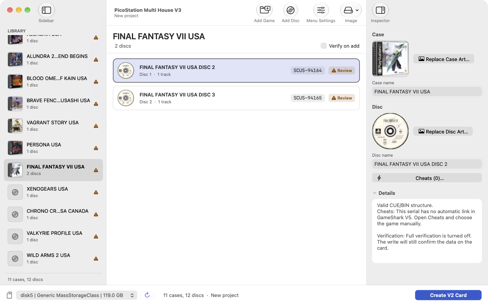

# PicoStation Multi House V3 for macOS

A native macOS (Apple Silicon, arm64) port of **PicoStation Multi House V3 Manager**, the tool that
builds the "V2" SD card layout used by the PicoStation Multi House firmware: cases, discs, cover art,
GameShark cheats, menu and music, written straight to the SD card.

The original is a Windows x64 program. This repository re-implements it in C11 (core) and AppKit (UI),
based on reverse engineering the executable. Same data formats, same validation rules, the same behavior, with a modern native Mac interface in EN-US.

## Credits

The original program, the Multi House firmware and the data formats are the work of **ALBERONISSE**:

- [alberonisse/PicoStation_MultiHouse](https://github.com/alberonisse/PicoStation_MultiHouse)
- [alberonisse/PicoStation_Manager](https://github.com/alberonisse/PicoStation_Manager)
- [alberonisse/PicoStation](https://github.com/alberonisse/PicoStation) (firmware, a fork of [paulocode/picostation](https://github.com/paulocode/picostation))

This port is independent and unofficial. The design of Multi House belongs entirely to ALBERONISSE.
The embedded databases (disc identification, Redump hashes, GameShark V5 cheats, the console menu, the
case template and the music) were extracted from the original executable with
`tools/extract_embedded.py`; see `docs/EMBEDDED_DATA.md`.

## Install

Requires a Mac with Apple Silicon (M1 or newer) and macOS 12 or later. Intel Macs are not supported
(the build is arm64 only).

```sh
curl -fsSL https://raw.githubusercontent.com/orenatobr/PicoStation-MultiHouse-macOS/main/install.sh | bash
```

The script downloads the latest release, checks its SHA-256, installs the app into `/Applications` without
the quarantine flag, and replaces an existing install, so running it again updates the app. To install by
hand instead:

```sh
curl -L -o ~/Downloads/PicoStation-Multi-House-V3-macOS-arm64.zip \
  https://github.com/orenatobr/PicoStation-MultiHouse-macOS/releases/latest/download/PicoStation-Multi-House-V3-macOS-arm64.zip \
  && ditto -x -k ~/Downloads/PicoStation-Multi-House-V3-macOS-arm64.zip /Applications \
  && open "/Applications/PicoStation Multi House V3.app"
```

This installs the app into `/Applications`. Run it from a normal APFS volume: macOS may refuse to
launch an app that was extracted to an exFAT or NTFS drive.

`curl` does not mark the file as downloaded from the internet, so Gatekeeper does not block the app
(it is ad-hoc signed, without a developer certificate). If you download it with a browser instead,
macOS refuses the first launch: right-click the app and choose Open, or run
`xattr -dr com.apple.quarantine "PicoStation Multi House V3.app"`.

The SHA-256 of the zip is published as a `.sha256` file in the same release.

### Default cover art

Case and disc art are not bundled in the app. When you add a game, the app reads its serial and downloads
`<SERIAL>-CASE.art` and `<SERIAL>-CD.art` from
[orenatobr/PicoStation-MultiHouse-art](https://github.com/orenatobr/PicoStation-MultiHouse-art) into
`database/art/default`, so each cover is fetched once and new games need nothing else. Offline, or for a serial the
repository lacks, the game just keeps the program's own generated cover; you can still pick your own image with
**Case Art** and **Disc Art**. Set `MH_ART_URL` to use another mirror.

The app also reads art from a `database/art/default` folder that already exists, searched in this order:

1. `$MH_DATA_DIR/database`
2. next to the `.app` (for example `Managers/database`)
3. inside the app, under `Contents/Resources`
4. `~/Library/Application Support/PicoStation Multi House/database`

## Usage



The window has three panes: the **Library** sidebar (one row per case), the discs of the selected case
in the middle, and an inspector with the cover art, names and cheats on the right. The bottom bar holds
the card picker and the primary button. Dark mode is supported.

1. Drag game folders or `.cue` files onto the window, or use **Add Game** and **Add Disc** in the
   toolbar. Each CUE is checked (structure, serial, Redump hash) when "Verify on add" is ticked.
   **Remove Game** and **Remove Disc** delete what is selected: select several rows (shift-click or
   command-click) to remove several games or several discs at once, after one confirmation.
2. Adjust names, cover art, cheats and the menu (**Menu Settings**). Reorder discs and cases by dragging,
   or with Move Up and Move Down (option-command-up and option-command-down).
3. Pick the card in the bottom bar and press **Create V2 Card**. A confirmation sheet asks you to
   authorize the raw write, and macOS asks for an administrator password to open the raw disk. You can
   also save everything as an image (**Image** menu), and open existing V2 images and cards for editing.

All commands are also in the menu bar, and the whole UI works from the keyboard.

### Write safety

Writing is raw and destroys everything on the card. The app only offers whole disks that look like
cards (USB, SD or MMC, removable, up to 130 GB), never the system disk or internal disks. Before
writing it re-checks the disk identity (number, size, model, serial), unmounts the volumes and requires
the confirmation checkbox. Even so, double-check the disk name in the list.

### Verification status

- The card layout was checked field by field against the V3 firmware (`docs/FIRMWARE_CROSSCHECK.md`).
- Images and virtual disk devices (`hdiutil attach -nomount`) were written, read back and validated.
- **It has not yet been tested with a physical SD card or a console.** On first use, try a card with no
  important data and report the result.

## Known limitations (inherited from the original or the firmware)

- Custom cheat profiles in the v4 format with more than 256 lines are accepted by the program, but the
  firmware ignores them (the disc ends up without cheats).
- Titles with accented characters show blanks in the console menu (the firmware only displays ASCII).
- Several messages still mention "Windows" or "PhysicalDrive": the texts were kept as in the original.

## Build

```sh
make app                # builds ~/.cache/picostation-mh-build/PicoStation Multi House V3.app
tools/package.sh 0.1.0  # builds dist/PicoStation-Multi-House-V3-macOS-arm64.zip
make test               # core tests (ASan/UBSan), takes a few minutes
make test-v2            # one module: base, disc, cheat, art, menu, v2, blockdev
```

Needs the Xcode Command Line Tools. Output goes to `~/.cache/picostation-mh-build` (override with `BUILD=`).
Tests use real games from `/Volumes/Renato/PicoStation BR` when present and skip the rest.
Disk test without hardware: `tools/test-disk.sh --images`.

## How the port was made

The original executable (mingw-w64, with symbols) was decompiled with Ghidra. Every function was
rewritten and then audited by a second reviewer. The "original function to port function" tables are in
`docs/map/`, the audit reports in `docs/audit/`, the conventions in `docs/PORTING.md`.

```
core/        portable C11 core (base, disc, cheat, art, menu, v2)
platform/mac disk access (DiskArbitration, authopen) and images (ImageIO)
app/         AppKit user interface
resources/   data extracted from the original executable, and the icon
docs/        maps, formats, audits, firmware cross-check
tools/       data extraction, packaging, disk tests
```

## License

Apache License 2.0, the same as the upstream PicoStation repositories. See `LICENSE`.
